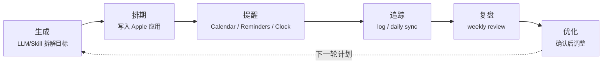

<p align="center">
  <h1 align="center">Nudge</h1>
  <p align="center">
    AI 私人教练兼生活管家
    <br />
    <strong>生成 · 排期 · 提醒 · 追踪 · 优化</strong>
    <br />
    <br />
    <a href="README.md">English</a> · <a href="https://github.com/Zenine/nudge/issues">报告 Bug</a> · <a href="https://github.com/Zenine/nudge/issues">功能建议</a>
  </p>
</p>
<p align="center">
  <a href="https://github.com/Zenine/nudge/stargazers"></a>
  <a href="https://github.com/Zenine/nudge/blob/master/LICENSE"></a>
  <a href="https://www.python.org/"></a>
  <a href="https://github.com/Zenine/nudge/issues"></a>
</p>

---

**AI 能帮你做计划，Nudge 盯着你把计划做完。**

Nudge 是一个 local-first 的 macOS 命令行工具：把自然语言计划写入 Apple 日历 / Apple 提醒事项 / Apple Notes / Clock，跟踪完成情况，并在复盘时给出调整建议。它通过 iCloud 同步到 iPhone，但本机 Apple 权限和本地 SQLite 状态仍由 Mac 负责。

当前阶段是 **Mac + iPhone 本地 CLI**。Cloud、Bot、iOS App、Marketplace 和外部试点都不在 README 展开；产品定义、路线图与商业化判断属于维护者的私有规划文档，不随公开仓库分发。

## 读者入口

| 如果你是 | 先看 |
|----------|------|
| 第一次试用的人 | [快速开始](#快速开始) |
| 日常使用者 | [常用命令](#常用命令) |
| AI agent / 其他项目 | [AI / Agent 接入](#ai--agent-接入) |
| 维护者 | [项目结构](#项目结构)、[源码模块地图](docs/module-map.md)、[私有 fork 升级说明](docs/PRIVATE_FORK_UPGRADE.md)、[CONTRIBUTING.md](CONTRIBUTING.md) |
| 产品/架构读者 | [Architecture v2](docs/architecture.md)、[Design v2](docs/design.md)、[Apple Adapter 调研](docs/apple-adapter-survey.md) |

一句话判断：**自然语言输入走 `nudge do` / 根命令；已经有结构化 action 就走 `agent apply` / MCP，跳过 LLM。**

## 它做什么



核心能力：

- 自然语言生成 Calendar / Reminders / Notes / Clock action。
- `nudge doctor` 检查本机配置、LLM key 和 Apple 权限。
- `nudge log` / `nudge check-in` 记录完成、跳过、部分完成、延期、阻塞。
- `nudge daily sync` 同步 Reminders 完成候选、近期 HealthExport 汇总和 docs audit 结果。
- `nudge review weekly --adapt` 生成复盘和安全调整建议；复盘上下文会带上近期健康摘要、每周主观打分和长期画像。
- `nudge feedback weekly-score` 记录难度 / 恢复 / 睡眠 / 情绪 1–10 的每周主观打分，写入本地 `evaluations`。
- `nudge profile build/show` 从本地 action 反馈推导偏好时段与阻塞模式，形成可复用的长期画像上下文。
- 提醒类 action 支持 `notify` 字段：`notify=false` 只登记事项、不产生到点通知；家庭路由规则可用 `notification_policy = "prestart_only"` 只保留课前提醒。
- `nudge failures --due-soon-minutes 60` 把"临近到期但未完成"也纳入主动跟进，而不只是已逾期。
- `nudge agent apply` 和 `nudge mcp serve` 给其他本机 agent 使用稳定 JSON / MCP 契约。
- Skill Spec 提供可验证、确定性的个性化规则执行，见 [docs/skill-spec.md](docs/skill-spec.md)；`nudge skills start/status/adapt` 负责实例化与逐周推进，`nudge skills schedule` 负责把 dry-run 结果经 agent 确认后批量落到 Apple。

更完整的能力边界见 [命令参考](docs/commands.md) 和 [Architecture v2](docs/architecture.md)。

## 快速开始

先把底座跑通，再写真实日历/提醒事项：

1. 安装命令入口。
2. 配好一个 LLM key。
3. 跑 `nudge doctor` 检查本机权限。
4. 用 `--dry-run` 看解析结果。
5. 确认无误后再真实写入。

一键安装：

```bash
git clone https://github.com/Zenine/nudge.git
cd nudge
scripts/bootstrap_mac.sh
```

普通用户不需要手动创建或激活虚拟环境；`scripts/bootstrap_mac.sh` 会自动创建 `.venv`、安装依赖、安装 `nudge` 命令，并避免把依赖写进系统 Python。在 Apple Silicon Mac 上，脚本会优先使用 `/opt/homebrew/bin/python3`，并拒绝用 Rosetta / x86_64 Python 创建虚拟环境；如果已有 `.venv` 是 Intel 环境，会先备份再重建。

手动安装（开发者）：

```bash
python3 --version                  # 建议 Python 3.12+
python3 -m venv .venv
.venv/bin/python -m pip install -r requirements.txt
scripts/install_cli.sh
nudge --help
```

首次配置：

```bash
export DASHSCOPE_API_KEY="your-key"
nudge doctor
nudge --dry-run "明天早上8点开会"
```

`uv` 也可以使用，但不是必需：

```bash
UV_PYTHON=/opt/homebrew/bin/python3 uv venv .venv
source .venv/bin/activate
uv pip install -r requirements.txt
scripts/install_cli.sh
```

## 推荐使用流程

1. `nudge doctor` 检查配置、LLM key 和 Apple 权限。
2. `nudge --dry-run "..."` 先看解析结果，不写 Apple 应用。
3. `nudge "..."` 在确认无误后写入 Calendar / Reminders / Notes / Clock。
4. `nudge log ...` 记录真实完成、跳过、部分完成、延期或阻塞。
5. `nudge daily sync --json` 同步 Reminders 完成状态、HealthExport 汇总和 docs audit 结果。
6. `nudge review weekly --adapt --dry-run` 做周复盘和安全调整建议。
7. 需要自动化时再启用 `scripts/bootstrap_launchd.sh`，让 morning brief、daily sync、evening brief 和 daemon 固定运行。

这个顺序的核心是：**先诊断，再 dry-run，再真实写入；先同步事实，再让复盘调整计划。**

## 自动维护

如果你希望每天自动触发：

```bash
scripts/bootstrap_launchd.sh
```

默认会安装 morning briefing、daily sync、evening briefing 和无头 daemon。daily sync 会运行 `nudge daily sync --apply --json`，同步 Reminders / Health，并带上 docs audit；如果发现文档维护债，只创建本地 maintenance action，不自动改文档。

查看状态：

```bash
scripts/bootstrap_launchd.sh status
nudge daemon launchd status --json
nudge daemon health --json
nudge daemon health --notify
```

不用了可以移除：

```bash
scripts/bootstrap_launchd.sh uninstall
```

可调整时间（环境变量）：

- `NUDGE_MORNING_HOUR` / `NUDGE_MORNING_MINUTE`
- `NUDGE_DAILY_SYNC_HOUR` / `NUDGE_DAILY_SYNC_MINUTE`
- `NUDGE_EVENING_HOUR` / `NUDGE_EVENING_MINUTE`
- `NUDGE_DAEMON_SLEEP_MS`
- `NUDGE_DAEMON_STALE_MINUTES`
- `NUDGE_DAEMON_MAX_ATTEMPTS`
- `NUDGE_DAEMON_MAX_QUEUE_DEPTH`
- `NUDGE_BRIEFING_NOTIFY=1|0`

生成的 plist：

- `~/Library/LaunchAgents/com.nudge.morning.plist`
- `~/Library/LaunchAgents/com.nudge.daily-sync.plist`
- `~/Library/LaunchAgents/com.nudge.evening.plist`
- `~/Library/LaunchAgents/com.nudge.agent.plist`

只管理无头 daemon，不影响早晚 briefing 定时任务：

```bash
nudge daemon launchd install
nudge daemon launchd stop
nudge daemon launchd start
nudge daemon launchd restart
nudge daemon health
nudge daemon health --notify
nudge daemon app install --login-item
nudge daemon app open
```

脚本会写入：

- `~/Library/LaunchAgents/com.nudge.morning.plist`
- `~/Library/LaunchAgents/com.nudge.daily-sync.plist`
- `~/Library/LaunchAgents/com.nudge.evening.plist`
- `~/Library/LaunchAgents/com.nudge.agent.plist`

日志目录：`~/Library/Logs/`

## 配置示例

复制示例配置为本机配置后再编辑（`config.toml` 已加入 `.gitignore`，不要提交本机日历、状态目录或密钥路径）：

```bash
cp config.example.toml config.toml
```

编辑 `config.toml`：

```toml
[llm]
provider = "qwen"                   # 或 "anthropic"、"openai"、"deepseek"、"ollama"

[llm.models]
fast = "qwen-plus"
default = "qwen-plus"
strong = "qwen-plus"

[general]
default_calendar = "个人"
default_reminder_list = "日常"

# 可选家庭路由示例。不需要家庭提醒路由时可删除或按需调整。
[family.dad]
aliases = ["爸爸", "爸"]
calendar = "个人"
reminder_list = "家庭"

[family.mom]
aliases = ["妈妈", "妈"]
calendar = "个人"
reminder_list = "家庭"

[family.routing]
default = "all"
llm_fallback = true

[family.routing.display]
title_prefix = false
body_assignee_note = true

[[family.routing.rules]]
id = "kids_courses"
keywords = ["课程", "上课", "接送"]
assignees = ["mom"]
```

默认示例使用 Qwen / DashScope；如果希望更 local-first，可以把 provider 改为 `ollama`，并把模型改成本机已拉取的 Ollama 模型。真实密钥仍建议放在环境变量或外部 `secrets.yaml`，不要写进仓库。

可选家庭路由示例：家庭组提醒支持“关键词规则优先 + LLM 兜底”的接收人路由：例如课程/接送类事项可路由给妈妈，缴费类事项可路由给爸爸和妈妈，家庭会议仍可路由给所有成员。默认会用 `妈妈：事项标题` 这种成员名标题前缀表达归属；可通过 `[family.routing.display]` 把 `title_prefix=false` 改为不在标题显示负责人，并用 `body_assignee_note=true` 在备注中写入 `负责人：姓名` 以保留归属审计信息。`default = "all"` 会为每个家庭成员各创建一条 reminder；如果这些 reminder 写入同一个 iCloud 共享列表，到点通知仍取决于每位成员是否加入该列表以及各自设备的 Reminders 通知设置。当前 Apple 公开 EventKit / Reminders 自动化接口没有稳定的原生 assignee / “分配提醒事项”字段，因此 Nudge 不依赖 iOS 私有指派能力，继续用“多条成员副本 + 备注负责人”的可移植方案。`--json --dry-run` / JSON 输出会在 `actions[].routing` 解释来源和命中规则；普通人类可读 dry-run 不承诺显示完整 metadata。启用 `llm_fallback=true` 时，会把最小化后的家庭事项内容、成员 key/display_name/role、路由规则摘要发送给配置的 LLM provider；隐私优先可改为 `llm_fallback=false`，未命中关键词时只走 default。

## 常用命令

完整命令、返回码、JSON 字段、daemon、Health、Skill 和错误处理见 [docs/commands.md](docs/commands.md)。

```bash
# 自然语言排期
nudge "下周二下午2点项目会"
nudge --dry-run "明天3点接孩子"
nudge --json --dry-run "明天3点接孩子"

# 本机诊断
nudge doctor
nudge doctor --json

# 反馈和复盘
nudge log done
nudge log partial "只做了一半"
nudge log parse "阅读完成了，读了 30 分钟，体感 7 分"
nudge feedback weekly-score --difficulty 6 --recovery 7 --sleep 5 --mood 8
nudge daily sync --json
nudge profile build --json
nudge review weekly --adapt --dry-run

# 自动化和文档维护
scripts/bootstrap_launchd.sh status
nudge docs audit
nudge docs audit --json

# 健康和数据库维护
nudge health import path/to/health-export.json --from 2026-04-21 --to 2026-04-28 --json
nudge db backup
nudge db export

# Skill
nudge skills list
nudge skills show strength-basics-12w
nudge skills dry-run strength-basics-12w --context context.json --json
```

## AI / Agent 接入

给 AI agent 或其他本机项目的最短规则：

1. 需要理解自然语言时，先 dry-run：

```bash
<repo>/bin/nudge do --json --dry-run "明天下午3点开会"
```

2. 已经有结构化 action 时，跳过 LLM：

```bash
<repo>/bin/nudge agent apply --file request.json --json
```

3. 需要 MCP tool 时，启动：

```bash
<repo>/bin/nudge mcp serve
```

接入边界：

- 做真实写入前先 dry-run。
- 批量计划写入必须有人类可读计划并确认。
- 解析或写入失败时，不要整条原始输入盲目重试；读取 JSON 里的 `failures` / `errors`，只处理失败项。
- MCP 默认只暴露受控写入、`doctor_status` 和固定 `Nudge` Notes folder 标题列表。
- MCP 不提供任意文件、密钥、Calendar、Reminders、Notes 正文读取能力；安全边界见 [docs/mcp-security.md](docs/mcp-security.md)。

## 配置与密钥

`config.toml` 保存本机配置，已加入 `.gitignore`，不要提交本机日历、状态目录或密钥路径。长期密钥不要写入仓库。

Nudge 可以从 provider 专用环境变量读取 key，也可以通过 `NUDGE_SECRETS_PATH` 或本机 `config.toml [llm].secrets_path` 指向一个本机私有 `secrets.yaml`。

环境变量示例：

```bash
export DASHSCOPE_API_KEY="your-key"
```

支持的 LLM provider 包括 Qwen / DashScope、Anthropic、OpenAI、DeepSeek 和 Ollama。详细配置见 [docs/configuration.md](docs/configuration.md) 与 [docs/llm.md](docs/llm.md)。

## macOS 权限

首次真实访问 Calendar、Reminders、Mail、Notifications 或 Automation 时，macOS 可能弹出权限确认。请在 **系统设置 → 隐私与安全性** 中允许启动 Nudge 的终端、IDE、Agent 或 Python 解释器。

最小建议顺序：

1. `nudge doctor`
2. `nudge --dry-run "..."`
3. `nudge "..."`
4. 确认 Apple Calendar / Reminders 中出现目标项
5. 删除 smoke test 产生的测试项

如果只配置 Calendar / Reminders，Clock 快捷指令缺失不会阻塞基本使用。

## 项目结构

```text
nudge/
├── bin/nudge                 # 固定路径 CLI wrapper，给其他项目 / Agent 调用
├── nudge/                    # 核心包
│   ├── cli.py                # Click CLI 路由
│   ├── commands/             # CLI 子命令
│   ├── apple/                # Apple Calendar / Reminders / Notes / Clock 适配
│   ├── skills/               # Skill Spec 验证和确定性执行
│   ├── brain.py              # Prompt、AI 解析、briefing、adaptation
│   ├── llm.py                # 多 provider LLM 抽象
│   ├── state.py              # SQLite 本地状态
│   └── config.py             # 配置与密钥加载
├── docs/                     # 架构、命令、配置、安全、Skill 等文档
├── scripts/                  # bootstrap、install、verify
└── tests/                    # 自动化测试
```

源码阅读和常见修改入口见 [docs/module-map.md](docs/module-map.md)。

## 文档索引

- [docs/commands.md](docs/commands.md)：命令、JSON 契约、返回码、外部调用示例。
- [docs/architecture.md](docs/architecture.md)：local-first 架构和模块边界。
- [docs/configuration.md](docs/configuration.md)：配置项与安全默认值。
- [docs/llm.md](docs/llm.md)：LLM provider 选择与密钥注入。
- [docs/design.md](docs/design.md)：交互设计和产品约束。
- [docs/module-map.md](docs/module-map.md)：源码模块地图与常见修改入口。
- [docs/mcp-security.md](docs/mcp-security.md)：MCP 工具安全边界。
- [docs/skill-spec.md](docs/skill-spec.md)：Skill 模板和个性化规则契约。
- [docs/prompt-playbook.md](docs/prompt-playbook.md)：Prompt 维护和调优。
- [docs/daemon-runbook.md](docs/daemon-runbook.md)：daemon 故障恢复和人工回放。
- [docs/apple-adapter-survey.md](docs/apple-adapter-survey.md)：Apple backend 调研和 adapter 选型。
- [docs/deployment-checklist.md](docs/deployment-checklist.md)：本机部署前检查清单。
- [docs/non-macos.md](docs/non-macos.md)：非 macOS 环境的评估边界。
- [docs/releasing.md](docs/releasing.md)：发布 checklist。
- [docs/PRIVATE_FORK_UPGRADE.md](docs/PRIVATE_FORK_UPGRADE.md)：以私有 fork 承载个人数据时，如何依赖并升级本公开库。

## 测试

```bash
scripts/verify.sh              # 推荐：测试 + CLI 冒烟检查
python3 -m pytest tests/ -v    # 仅测试套件
```

pre-commit 应调用仓库验证入口。不要绕过失败的钩子。

## 参与贡献

欢迎贡献！请先阅读 [CONTRIBUTING.md](CONTRIBUTING.md)，再开 issue 讨论你想做的改动。

## 许可证

[AGPL-3.0](LICENSE)
