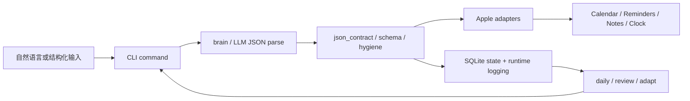
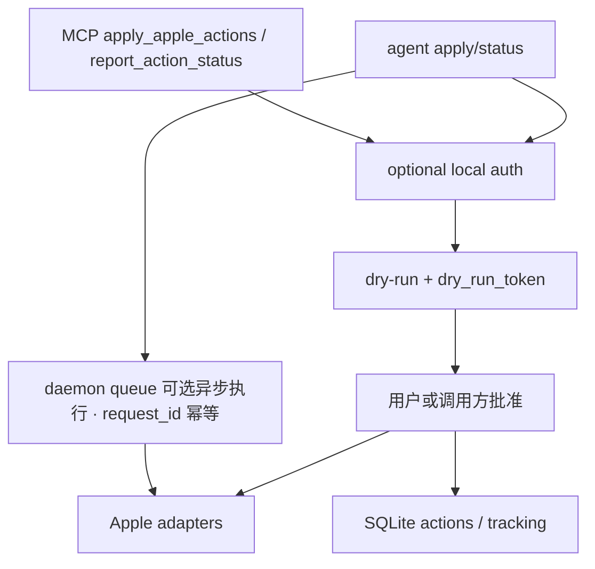
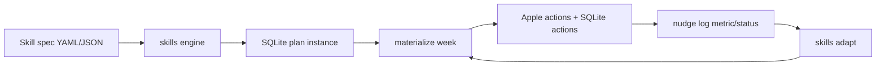

# 架构与数据流

Nudge 是一个 local-first 的 macOS CLI：把自然语言或结构化计划转成 Apple Calendar、Reminders、Notes 和 Clock 动作，并把执行状态保存在本机 SQLite。公开仓库只包含可复用 runtime、CLI、Apple adapters、daemon、MCP wrapper、Skills/trainer runtime 与安装脚本；私人计划、个人配置、API key、健康导出、本机 SQLite 状态和用户专属资料不属于公开仓库内容。

本文面向贡献者和外部用户，帮助理解 runtime 如何串联。完整命令入口见 [`docs/commands.md`](commands.md)，配置与安全默认值见 [`docs/configuration.md`](configuration.md) 和 [`SECURITY.md`](../SECURITY.md)。

相关文档：[Design](design.md) · [Module Map](module-map.md) · [Skill Spec](skill-spec.md) · [Prompt Playbook](prompt-playbook.md) · [Apple Adapter Survey](apple-adapter-survey.md) · [MCP Security](mcp-security.md) · [Daemon Runbook](daemon-runbook.md) · [LLM](llm.md) · [非 macOS 环境](non-macos.md) · [TODO](../TODO.md)

## 架构原则

系统中心是 **本地 CLI + Apple 应用 + SQLite 状态 + LLM + 确定性 Skill Engine**，而不是 Cloud、Bot、App 或 Marketplace。据此有以下长期原则：

1. **Local-first**：默认在用户本机运行，不依赖云端服务。
2. **Mac + iPhone 优先**：Mac 写入 Apple Calendar / Reminders / Notes，通过 iCloud 同步到 iPhone。
3. **文档确认先于计划写入**：长期计划、周计划、Skill 或复盘调整要批量写入 Apple Calendar / Reminders / Clock / Notes 前，必须先生成或更新人类可读的文本计划 / 变更说明，并经用户确认。这是产品级安全边界，不是某类计划的例外流程。
4. **副作用明确**：写 Calendar / Reminders / Notes / Clock 必须能 dry-run、可诊断、可解释失败。
5. **LLM 不拥有执行权**：LLM 只生成候选 action；代码负责校验、写入、记录。
6. **SQLite 是反馈真相**：Calendar 负责排期，Reminders 可提供打勾信号，完成/延期/阻塞等状态最终必须回到本地 action log。
7. **远程不直连本机**：跨设备同步通过 relay 和设备出站连接完成，不把用户 Mac 暴露成公网 HTTP / 任意 RPC 服务。
8. **iCloud 不是授权**：Apple ID / iCloud 只负责 Apple 数据同步，每台 Mac / iPhone 都必须单独授予 Nudge 本机权限。
9. **iOS 不是常驻服务器**：iOS App 可做随身反馈、通知和部分 EventKit 执行，但不能假设 24 小时后台常驻。
10. **Skill 不执行任意代码**：Skill 走 YAML/JSON schema、JSONLogic 子集和 patch 白名单。
11. **后续阶段可抽取**：本地模块边界要清晰，未来能抽成 relay / API，但现在不提前造云平台。
12. **计划生成必须客观 + 主观**：每次生成下一轮 1-2 周执行计划，必须先合并客观信号（App/健康/Reminders/周报）和主观体验（主观难度、恢复、睡眠、情绪），再决定是否加量、降级或取消。

## 总览



高层分层：

- `nudge/cli.py` 注册 Click CLI，并把未知裸文本路由到 `nudge do`。
- `nudge/commands/*` 是用户可见命令层，负责读配置、解析参数、选择 dry-run 或真实写入。
- `nudge/brain.py` 负责 LLM 调用和 JSON 提取；`nudge/json_contract.py`、命令内 schema 检查和 `nudge/action_hygiene.py` 负责稳定输出契约与轻量规范化。
- `nudge/apple/*` 是 Apple App 边界，隐藏 AppleScript、EventKit、Shortcuts 等后端差异。
- `nudge/state.py` 管理本机 SQLite：计划、动作、健康汇总、习惯、daemon 队列（含 `request_id` 幂等主键）和运行记录。

同一分层的文字版本如下：

```text
┌──────────────────────────────────────────────────────────────┐
│ User / Other Projects / Agent                                │
│   nudge "..."                                                │
│   <repo>/bin/nudge "..."                                     │
└───────────────────────────────┬──────────────────────────────┘
                                │
                                ▼
┌──────────────────────────────────────────────────────────────┐
│ CLI Layer                                                    │
│ nudge/cli.py + nudge/commands/*                              │
│ do · doctor · briefing · review · schedule · habits · skills │
└───────────────┬───────────────────────┬──────────────────────┘
                │                       │
                ▼                       ▼
┌─────────────────────────────┐  ┌─────────────────────────────┐
│ Brain / LLM                 │  │ Skill Engine                │
│ nudge/brain.py              │  │ nudge/skills/*              │
│ nudge/llm.py                │  │ schema · jsonlogic · patch  │
│ 多 provider SDK             │  │ deterministic apply         │
└───────────────┬─────────────┘  └──────────────┬──────────────┘
                │                               │
                └───────────────┬───────────────┘
                                ▼
┌──────────────────────────────────────────────────────────────┐
│ Execution Layer                                              │
│ nudge/apple/* · nudge/health.py · nudge/state.py             │
│ AppleScript → Calendar / Reminders / Notes create/list       │
│ Swift/EventKit → Calendar 范围读取 + Reminders 读写           │
│ Apple Health export ZIP → 每日聚合 + workout 元数据           │
│ SQLite → NUDGE_STATE_DIR 或 [state].dir 指定的状态目录        │
└───────────────┬───────────────────────────────┬──────────────┘
                │                               │
                ▼                               ▼
        Apple Calendar / Reminders / Notes    Local SQLite state
                │
                ▼
        iCloud sync → iPhone
```

### 运行时依赖

| 依赖 | 用途 |
|------|------|
| Python 3.12+ | CLI 和本地逻辑 |
| click | CLI 子命令 |
| openai / anthropic 等 provider SDK | LLM 调用 |
| PyYAML | Skill YAML 读取 |
| defusedxml | Apple Health 导出 XML 安全解析 |
| sqlite3 | 本地状态，Python 内置 |
| osascript / AppleScript | Calendar、Reminders、Notes 创建/列表、Mail、通知集成；EventKit 不可读时作为 Calendar/Reminders fallback |
| Swift / EventKit | Calendar 配置日历范围读取；Reminders 今日到期读取、完成、删除，规避 AppleScript 在大列表上按 date/name 过滤 timeout |
| shortcuts CLI | 通过本机 `Nudge Create Alarm` 快捷指令桥接 Apple Clock alarm；Clock 本身不依赖 AppleScript 字典 |

## 模块边界

| 模块 | 文件 | 职责 | 不负责 |
|------|------|------|--------|
| CLI router | `nudge/cli.py` | Click 根命令、默认自然语言转 `do` | 业务逻辑 |
| Commands | `nudge/commands/*` | 子命令编排、用户输出、错误转 ClickException | 低层 AppleScript、LLM SDK 细节 |
| Agent Relay | `nudge/commands/agent.py` | 其他本机 agent / MCP wrapper 提交结构化 Apple actions 的中转站；不调用 LLM，复用 adapter、dry-run、JSON contract 和 SQLite tracking | 直接操作 AppleScript/EventKit、远端工具鉴权 |
| MCP Server | `nudge/commands/mcp.py` | 通过 stdio JSON-RPC 暴露写入 tool `apply_apple_actions`、状态回写 `report_action_status`、只读诊断 `doctor_status` 和窄读取 `list_nudge_notes` | 普通 stdout 日志、任意 Calendar/Reminders 读取、任意 Notes folder 或正文读取 |
| Daemon | `nudge/commands/daemon.py` | SQLite 命令队列入队、claim、执行、stale 回收、健康聚合与自启动控制面 | 远程控制面、绕过 agent 安全契约 |
| Brain | `nudge/brain.py` | prompt、JSON 解析、briefing/review/adapt/check-in parse 逻辑 | 写入 Calendar / Reminders |
| LLM | `nudge/llm.py` | provider 抽象、API 调用、模型档位 | prompt 业务策略 |
| Config | `nudge/config.py` | `config.toml`、私有 secrets 文件、默认值 | 业务执行 |
| Adapt | `nudge/adapt.py` | 把 LLM 调整建议转换为 safe/unsafe 执行计划，并在确认后更新带 `external_id` 的 Calendar action | 生成建议、绕过用户确认 |
| Apple | `nudge/apple/*` | AppleScript 读写封装；Calendar 配置日历读取和 Reminders due-today / complete / delete 通过 Swift/EventKit 原生查询和 mutation；Notes 写指定 folder，并可只列 `Nudge` folder 标题；Clock alarm 通过 Shortcuts bridge | CLI 展示、状态记录 |
| Health import | `nudge/health.py` / `nudge/commands/health.py` | 解析 Apple Health 导出 ZIP，生成每日聚合和 workout 元数据；默认 dry-run，`--apply` 后写 SQLite | HealthKit 实时授权、后台同步、原始样本或 GPX 路线存储 |
| Errors | `nudge/errors.py` | 把 LLM / AppleScript / EventKit 原始错误分类成可操作 CLI 文案 | 低层重试策略、写入副作用 |
| State | `nudge/state.py` | SQLite plans/actions/habits/evaluations/chat_history、health 聚合表、daemon 队列与迁移记录 | LLM / AppleScript |
| Skills | `nudge/skills/*` | Skill spec 验证、内置样例发现和确定性规则执行 | LLM、真实日历写入 |
| Scripts | `scripts/*` | 安装和验证入口 | 产品逻辑 |

按文件粒度的完整索引见 [`docs/module-map.md`](module-map.md)。

### 关键边界规则

- `nudge/commands/do.py` 可以调用 Brain、Apple、State，但不直接拼 AppleScript。
- `nudge/commands/agent.py` 是结构化中转入口，只接受 JSON action envelope；`nudge/commands/mcp.py` 包装它，而不是绕过 Nudge 的 adapter / 错误 / tracking 层。
- `nudge mcp serve` 的 stdout 是 MCP JSON-RPC 通道，不能写普通日志；所有工具结果必须放在 `content` / `structuredContent` 中。MCP 安全边界见 [`docs/mcp-security.md`](mcp-security.md)。
- `nudge/skills/*` 不能调用 LLM、shell、网络或 Apple 应用。
- `nudge doctor` 只能只读检查，不写 Calendar / Reminders / Notes。
- `scripts/verify.sh` 是提交前验证入口，pre-commit 优先调用它。

## 核心自然语言数据流

常见路径是 `nudge --dry-run "..."` 或 `nudge "..."`：

1. `nudge/cli.py` 判断首个参数不是已知子命令时，自动转成 `do` 命令。
2. `nudge/commands/do.py` 读取配置、默认日历/提醒列表、家庭路由和 Apple backend。
3. `nudge/brain.py` 把自然语言解析为 JSON actions；解析层会处理 fenced JSON、前后说明文字和 JSON object/list 提取。
4. `do` 命令执行 schema/value 检查，给 CLI JSON 输出加 `schema_version`，并对提醒标题做轻量 hygiene。
5. dry-run 只展示计划，不写 Apple；真实执行调用 `nudge/apple/adapters.py` 解析出的 Calendar、Reminders、Notes、Clock backend。
6. 写入成功或失败的动作会记录到 SQLite，供 `log`、`daily`、`review`、`skills adapt` 和 daemon 状态查询使用。

核心契约很小：action 通常是 `calendar_event`、`reminder`、`note` 或 `alarm`，并带各自必需字段。命令层负责把这些 action 转成具体 Apple 写入调用，而不是让 LLM 直接调用 Apple App。

文字版路径与旁支行为：

```text
User text
  │
  ▼
CLI `do`
  │ load config + aliases
  ▼
Brain.parse_actions()
  │ LLM returns JSON actions
  ▼
format_action()
  │ dry-run? stop here
  ▼
Apple Calendar / Reminders / Notes writer
  │
  ├─ success → State.log_action(SQLite)
  └─ failure → user-visible error
```

| 旁支路径 | 行为 |
|------|------|
| 输入为空 | CLI 提示提供 message / file / pipe |
| 缺少 LLM key | `LLMError`，提示配置 provider key 或私有 secrets 文件 |
| LLM JSON 非法 | Brain 层捕获并给出解析失败 |
| Calendar 权限失败 | Apple 层返回 `(False, message)`，CLI 输出错误 |
| 部分 action 成功 | 成功的 action 写入 state，失败项显示错误 |

## 结构化 agent / MCP / daemon 数据流

结构化入口用于其他本地 agent 或 MCP client 代表用户发起动作。



关键关系：

- `nudge agent apply` 读取结构化请求，执行与 `do` 相同的 action schema 检查和 Apple 写入路径。
- MCP `apply_apple_actions` 是 JSON-RPC stdio tool surface，内部复用 agent apply；`report_action_status` 复用 agent status，把外部执行结果写回 SQLite。
- `agent apply` / MCP 写入接受可选 `request_id` 作为调用方 trace；直连路径不再按 `request_id` 做 replay 去重（历史机制已移除）。异步执行时，`daemon enqueue` 以 `request_id` 作为队列幂等键（`command_queue` 主键），避免重复入队。
- dry-run 会返回 `dry_run_token`。真实写入时保留已批准 payload 和 token，可防止“预览后 payload 被替换”。
- `[security.local_auth]` 默认关闭；启用后，`agent apply/status`、MCP `apply_apple_actions/report_action_status` 需要 `auth_token`，在 Apple 写入或状态更新前校验。
- daemon queue 把 `agent.apply` 类请求写入 SQLite 队列，由 `nudge daemon run` claim、执行、记录成功/失败和 stale retry。队列仍依赖 `request_id` 幂等，不绕过 agent 安全契约。

文字版中转路径：

```text
Other local agent / MCP client
  │ writes structured JSON request
  ▼
CLI `agent apply` 或 MCP `tools/call apply_apple_actions`
  │ validate request_id/source/actions
  │ plan-driven requests require text_plan_confirmed + text_plan_ref before dry-run
  │ no LLM, no natural-language parse
  ▼
Apple adapter selector
  │ native Calendar / native Reminders / native Notes / Shortcuts Clock
  ▼
Apple apps
  │ Calendar / Reminders / Notes / Clock writes
  ▼
Stable JSON response
  │ external_id, failures, errors
  ▼
SQLite action log for successful writes
```

当前支持 `calendar_event.create`、`reminder.create`、`alarm.create`、`note.create`；MCP tool `apply_apple_actions` 只做薄包装，把 tool args 转成同一份 request JSON。这样 Nudge 继续作为本机 Apple 操作中转站，统一处理权限、dry-run、部分失败、`external_id` 和错误分类。

计划驱动请求必须显式携带 `plan_driven=true`、`text_plan_confirmed=true` 和非空 `text_plan_ref`，否则 engine 会在 dry-run 前返回 `AGENT_TEXT_PLAN_CONFIRMATION_REQUIRED`；确认 token 同时绑定这些字段，避免 dry-run 后替换文本计划引用。

Notes 写入只创建新 note 到指定 folder，默认 `Nudge`；写入前会把 Markdown-ish 正文转换成人类可读的简单 Notes HTML，因为 Apple 备忘录不是 Markdown 渲染器。渲染器必须覆盖标题、列表、checkbox、强调、代码围栏和 Markdown 表格；测试必须断言 raw `#`、`- [ ]`、三反引号和 `|---|` 不会作为最终 Notes 正文残留。

MCP 只读能力限制为 `doctor_status` 和 `list_nudge_notes`：前者只返回 PASS/WARN/FAIL、message 和修复建议，不返回个人条目内容；后者只列固定 `Nudge` folder 的标题和标题派生摘要，不读取正文、不搜索、不更新、不删除。

## Doctor 只读诊断

```text
nudge doctor
  │
  ├─ load config
  ├─ create LLM provider and check API key
  ├─ list Calendar names
  ├─ list Reminders lists
  ├─ list Notes folders without reading note bodies
  └─ read Mail unread count
       │
       ▼
PASS / WARN / FAIL + 修复指引
```

`nudge doctor` 是排障的关键救援工具。Calendar / LLM 失败为 FAIL；Reminders / Mail 由于 macOS 权限或数据访问 timeout 可以是 WARN，但必须给出具体修复路径。doctor 还会显示当前 Apple backend（如 `backend=native` / `backend=shortcuts`）。

## Calendar 上下文读取

briefing、chat、schedule、trainer 需要读取 Calendar 作为上下文。由于 Apple Calendar 里可能有节假日、订阅、Siri 建议等大量系统日历，默认扫描所有日历会明显变慢甚至 timeout。当前策略是：

- `nudge doctor` 用一次性 `name of calendars` 查询检查可见列表。
- 日常上下文只查询 `config.toml` 中配置的日历：`default_calendar`、`[calendars]` 和家庭成员 `calendar`。
- 配置日历读取优先走 Swift/EventKit `predicateForEvents`；这需要 macOS Calendar **Full Access**。如果当前进程只有 write-only EventKit 权限，helper 会返回明确错误，Python 层回退到已收窄的 AppleScript 单日历查询。
- 需要参与排期的 Calendar 必须显式写入配置；不配置的订阅日历不会拖慢 Nudge。

## Skills / trainer 数据流

Skills 是确定性计划模板 runtime，trainer 是面向健身的兼容入口。



流程要点：

1. `nudge/skills/schema.py` 定义 Skill spec 形状；内置 spec 位于 `nudge/skills/builtins/`。
2. `nudge/skills/engine.py`、`jsonlogic.py`、`patch.py` 和 `dryrun.py` 根据 context 生成候选 plans/actions。
3. `nudge skills start <skill-id>` 创建 SQLite plan instance，并 materialize 首批 week actions；`--dry-run` 只预览。
4. materialize 阶段复用 Apple-safe runtime：真实写 Calendar/Reminders，并把 actions 记录到 SQLite。
5. `nudge log done --metric effort=8` 等命令把真实完成情况和指标写回 SQLite。
6. `nudge skills adapt <plan-id>` 读取 plan config 和已记录 actions/metrics，预览下一阶段；只有 `--apply` 才 materialize 后续 week 并推进 cursor。
7. `nudge trainer plan` 默认使用内置 strength Skill runtime；旧 LLM planner 仅作为显式兼容路径保留。

纯 spec 层的 validate / personalize / dry-run 路径：

```text
Skill YAML/JSON + context JSON
  │
  ▼
load_skill_file()
  │ yaml.safe_load / json.loads
  ▼
validate_skill()
  │ schema_version · required sections · JSONLogic · patch op · path safety
  ▼
personalize_skill()
  │ evaluate personalization.when
  │ apply patches
  ▼
apply_adaptations()
  │ evaluate adaptation.trigger
  │ apply patches
  ▼
dry_run_skill() 可选
  │ 从 plan_template.phases[].sessions[] 生成候选 Calendar action 预览
  ▼
Output personalized skill/template JSON 或 dry-run action JSON
```

此路径不调用 LLM，不读真实 Calendar，不写 Apple 应用，不读取 Skill 文件和 context 文件之外的数据。dry-run 只做确定性预览，真实空闲时间排期仍属于后续增强。

### Skill Engine 模块

| 模块 | 文件 | 职责 |
|------|------|------|
| Schema | `nudge/skills/schema.py` | 加载 YAML/JSON，校验必填字段、安全字段、rule 和 patch |
| JSONLogic | `nudge/skills/jsonlogic.py` | 执行安全 JSONLogic 子集 |
| Patch | `nudge/skills/patch.py` | 应用 `set/add/multiply/clamp/replace/remove/insert/tag/validate` |
| Engine | `nudge/skills/engine.py` | 编排 personalization 和 adaptation |
| Dry-run | `nudge/skills/dryrun.py` | 复用 engine 输出，生成无副作用的候选 Calendar action 预览 |
| Built-ins | `nudge/skills/builtins/*` | 打包训练、学习、工作效率等内置 Skill 样例，并提供 `list/show` 发现能力 |

Skill spec 字段定义见 [`docs/skill-spec.md`](skill-spec.md)。

### Skill 沙箱边界

Skill 不能：

- 执行 Python / JavaScript / shell。
- 读写文件系统。
- 访问网络。
- 读取密钥、环境变量、OAuth 文件。
- 调用 Apple 应用。
- 绕过用户确认修改日历。

Skill 可以：

- 声明 assessment。
- 声明 plan_template。
- 声明 tracking metrics。
- 用 JSONLogic 子集匹配 context。
- 用 patch 白名单修改模板。

## Health / daily / review 数据流

这些命令主要读写 SQLite，不直接创建新的 Apple 项。

- `nudge health import` 解析 Apple Health export ZIP 或 HealthExport JSON。XML 解析使用 `defusedxml`，并对导入范围与大小做防护；默认 dry-run，`--apply` 才把 daily summary、workouts 和 import metadata 写入 SQLite。
- `nudge reminders sync-completed` 读取 Apple Reminders 和 SQLite actions，把已经在 Apple 侧完成的提醒同步为本地 action 状态。
- `nudge daily sync` 汇总 Health 导入、Reminders completion、文档审计和 pending/overdue actions。默认预览；`--apply` 可以写入本地维护 action 或同步状态。
- `nudge review daily|weekly` 读取 actions、habit streaks 和近期状态生成复盘。`--adapt --dry-run` 只输出建议；`--adapt --apply` 才可能把安全适配计划写入 Calendar 或本地状态。

这些路径的设计目标是：外部数据先安全解析，进入 SQLite 后再由 daily/review/adapt 做汇总和建议，避免复盘命令直接依赖原始私密导出文件。

Health 导入的具体形状：

```text
Health export ZIP
  │
  ▼
CLI `health import`
  │ find HealthData XML
  │ stream parse Record / Workout
  │ dry-run? stop after counts
  ▼
SQLite health_imports / health_daily_summary / health_workouts
  │
  ▼
CLI `health daily` / 后续 review 输入
```

Nudge 只保存每日聚合和训练元数据：步数、距离、热量、运动分钟、睡眠、心率、HRV、体重、体脂、VO2Max，以及 workout 的 source/type/duration/distance/energy。第三方 App 只要已把数据写入 Apple 健康，就会通过 `sourceName` 进入 workout 和 `source_counts`。Nudge 不保存原始样本或 GPX 路线，导出包内的 `workout-routes/*.gpx` 只计数后忽略。

日期窗口使用 `[--from, --to)`，便于按 1-2 周执行窗口导入最近数据，而不是把多年健康记录默认变成日常工作集。直接 HealthKit / iOS Companion 自动同步仍属于后续 App 阶段能力。

## 执行闭环：Generate → Schedule → Track → Evaluate → Adapt

```text
Generate
  LLM / Skill 生成 action
    ↓
  1) 计划输入审查：客观指标 + 主观反馈评估
    ↓
Schedule
  Apple Calendar / Reminders 写入
    ↓
Track
  SQLite action log + check-in/log
  nudge log parse 可用 LLM 提取 status/note/metrics，但只更新 SQLite
  nudge reminders sync-completed 可把 Reminders completed 拉回为 done 候选
  Calendar 过去/移动/删除只作为待确认信号
    ↓
Evaluate
  review weekly 统计完成率和模式
  nudge dogfood weekly 汇总本周使用和 doctor 状态
    ↓
Adapt
  review weekly --adapt 生成建议
    ↓
User confirms
  safe action 更新 Calendar / SQLite
```

生成输入审查规则（统一要求）：

- 客观输入来源必须可追溯：Health 汇总（`nudge health daily`）、Reminders completed sync、Calendar 更新信号、`review weekly` / `dogfood weekly` 周报、复查异常状态。
- 主观反馈来源必须可记录：用户 check-in、反馈文本（`nudge log parse`）、以及每周总结里对执行难度、恢复、睡眠和情绪的评分。
- 决策输出必须给出两个闸门结果并与动作结论绑定：
  - 客观闸门是否允许加量：是 / 否
  - 主观闸门是否允许加量：是 / 否
  - 计划动作结论：`keep / split / reduce / reschedule / cancel / doctor`

`review weekly --adapt --dry-run` 会预览可执行调整，`--apply` 在确认后只更新带 `external_id` 的 Calendar action；`split` 会保留原 Calendar UID 作为第一段，并创建后续分段事件。缺少 `external_id` 的老 action 会显示为 unsafe，不按标题自动删除，避免误改真实日历。`nudge dogfood weekly` 是只读聚合层，读取 SQLite action 和 `nudge doctor` 结果，不调用 LLM，不写 Apple 应用；可用 `--json` 或 `--export-json` 输出机器可读周报。

## 反馈回流路径

完成结果不是从 Calendar 推断出来的。反馈流是：

```text
Apple Calendar / Reminders / Clock / Notes / briefing
  │ 触达用户
  ▼
User feedback
  │ nudge log/check-in
  │ nudge reminders sync-completed
  │ future: IM feedback inbox
  ▼
State.actions
  │ status: done / partial / skipped / deferred / blocked / skipped_after_sleep
  │ feedback: source / note / raw_text / metrics / reason / next_action
  ▼
review weekly / dogfood weekly / adapt
```

边界规则：

- Calendar 只负责高层时间块、每日目标和关键安排；事件过去、被移动或被删除，都不能直接写成完成状态。
- Reminders 适合细颗粒任务；`nudge reminders sync-completed` 可以按日期读取 Nudge 创建的 reminder completed 状态，作为 `done` 候选写回 SQLite。完成“关机流程 / 睡觉 / 上床 / 入睡”等睡眠终止型 reminder 后，同日晚于该时间的睡眠 reminder 会自动变为 `skipped_after_sleep`，表示已睡后作废，不计失败；在 `sync-completed --apply` 路径下，Nudge 会同时尝试把这些后续 Apple Reminders 标记完成，避免睡后继续响。
- Clock / 通知只负责强触达，不保存完成结果。
- Mail / briefing 负责批量拉回未反馈项和复盘问题，不作为紧急提醒渠道。
- `report_action_status` 已接入 MCP / agent status 回写；它只写 Nudge 本地 action 状态与反馈，不读取 Calendar / Reminders / Mail 内容。`doctor_status` 只返回诊断状态和修复建议；Notes 除 `list_nudge_notes` 标题列表外不开放正文读取。

## CLI JSON contract

外部项目调用 CLI 时优先读取 stdout 的单段 JSON。当前稳定契约：

- `do --json` / 默认入口 `--json`：解析和写入结果，包含 `actions`、`failures`、`errors`。
- `agent apply --json`：其他 agent 提交结构化 Apple actions 的中转结果，包含 `request_id`、`source`、`actions`、`external_id`、`failures`、`errors`。
- `mcp serve`：stdio JSON-RPC MCP server，`tools/list` 暴露 `apply_apple_actions`、`report_action_status`、`doctor_status` 和 `list_nudge_notes`，`tools/call` 返回 MCP `content` + `structuredContent`。
- `log parse --json`：自然语言 check-in 解析和本地 SQLite 更新结果。
- `skills ... --json`：Skill 发现、验证、执行、dry-run 结果。
- `dogfood weekly --json` / `--export-json`：只读周报结构化结果。

这些输出统一带顶层 `schema_version = "nudge.cli.v1"`。破坏性字段变更必须升级该版本；新增字段可以保持同版本，并继续保证失败时 stdout 仍是可解析 JSON。

## 本地状态边界

SQLite 是 Nudge runtime 的事实状态源，包含：

- `plans` / `actions`：Skill/trainer/do/agent 生成的计划与动作。
- `habit_logs`、`evaluations`、`chat_history`：习惯、评估和对话历史。
- `health_imports`、`health_daily_summary`、`health_workouts`：健康导入摘要。
- `command_queue`、`daemon_runs`：daemon 队列（`request_id` 幂等主键）与执行记录。
- `state_migrations`：legacy JSON state 迁移状态。

状态目录只由 `NUDGE_STATE_DIR` 或配置 `[state].dir` 决定；二者都缺失时，`STATE_DIR` 会退化为拒绝一切文件系统访问的占位路径，任何访问状态库的操作都 fail-closed 并以可读错误退出，禁止静默回退到源码树 `.nudge/`、XDG 或其它默认目录。不访问状态库的命令（如 `--help`、`docs audit`）不受影响。公开仓库不应包含本机 SQLite、legacy state、`config.toml`、API key/OAuth token、Apple Health 原始导出、真实日历/提醒/备忘录内容、个人计划或 app database snapshot。legacy JSON 迁移只在本机状态目录内进行，不应把旧状态文件纳入公开仓库。

## Apple adapter 边界

`nudge/apple/adapters.py` 定义 `CalendarBackend` / `RemindersBackend` / `NotesBackend` / `ClockBackend` 协议、统一 `WriteResult`，并由 config selector 为一次命令解析出 backend，把命令层与具体实现隔离：

- Calendar：`native`，项目内 EventKit 读快路径 + AppleScript 写入/fallback；支持创建事件、列出日历。
- Reminders：`native`，项目内 EventKit due-today / complete / delete 快路径 + AppleScript 列表/写入，并可探测读取权限。
- Notes：`native`，窄写入 surface，AppleScript 创建 note 到指定 folder；`note.create` 会把 Markdown-ish 输入渲染成人类可读的简单 HTML，并处理标题、列表、checkbox、强调、代码围栏和 Markdown 表格；doctor 只列 folder 名称；MCP `list_nudge_notes` 只列固定 `Nudge` folder 的标题、标题派生摘要和日期，不读取 note 正文。
- Clock：`disabled` 或 `shortcuts`；默认可禁用真实闹钟，需要时再接本机 `Nudge Create Alarm` Shortcuts bridge。

配置入口：

```toml
[apple.calendar]
backend = "native"   # 当前唯一已实现

[apple.reminders]
backend = "native"   # 当前唯一已实现

[apple.notes]
backend = "native"   # 当前唯一已实现

[apple.clock]
backend = "disabled" # 不写真实闹钟；需要时可切到 shortcuts
# backend = "shortcuts"
# shortcut_name = "Nudge Create Alarm"
```

命令层通过 selector 调用 adapter，不再直接绑定低层 Apple 函数。如果 config 选择尚未实现的 backend（如 `ical` / `rem` / `ekctl` / 外部 MCP），当前版本会显式 FAIL / `APPLE_BACKEND_UNSUPPORTED`，不会静默退回或半接入。

所有真实写入都应经过命令层确认或结构化 dry-run。dry-run 不创建 Apple 项；真实写入需要 macOS、对应 App 可用，并已授予 Calendar/Reminders/Notes/Shortcuts/Automation 等权限。`nudge doctor` 可用于检查常见权限和 backend 配置问题。

外部开源工具 `ical`、`rem`、`ekctl` 和第三方 MCP server 已进入调研范围，但不改变当前默认 runtime，详见 [`docs/apple-adapter-survey.md`](apple-adapter-survey.md)。无论未来接入哪种 backend，都必须保留 Nudge 的 dry-run、稳定 JSON、`external_id` 追踪、部分失败非 0、统一错误分类和 `nudge doctor` 诊断语义。

## 错误与权限边界

### macOS 权限矩阵

| 权限 | 当前入口 | 常见失败 | 处理 |
|------|----------|----------|------|
| Calendar | AppleScript + Swift/EventKit | 未授权、目标日历不存在、EventKit 只有 write-only 不是 full access | `nudge doctor` FAIL + 系统设置指引；上下文读取可回退到 AppleScript |
| Reminders | AppleScript + Swift/EventKit | 权限弹窗、EventKit full access 未授予、数据读取 timeout | WARN/FAIL + 用户在电脑前处理 |
| Notes | AppleScript | 自动化权限未授权、目标 folder 创建失败 | WARN/FAIL + 自动化权限指引；MCP/agent 只允许 create |
| Clock | Shortcuts CLI + Clock action | `Nudge Create Alarm` 快捷指令缺失、Shortcuts 卡住 | WARN + 创建 Shortcut 指引；可用 Calendar/Reminders 替代 |
| Mail | AppleScript 只读 | 自动化权限未授权 | WARN + 自动化权限指引 |
| Notifications | AppleScript | 通知权限被关 | 不阻塞核心路径 |

Reminders 权限曾是高优先级风险：AppleScript 可以列出列表，但在 `due date` / `name` 过滤大列表时 timeout。当前 due-today 读取、完成和删除已优先走 Swift/EventKit，AppleScript 保留为 fallback；后续若继续扩展 Reminders 查询，应优先复用 EventKit。

非 macOS 环境下的降级行为见 [`docs/non-macos.md`](non-macos.md)。

### 错误输出原则

- 用户能修的错误，要给修复指引。
- 系统权限错误不要伪装成 LLM 或解析错误。
- `doctor` 中 WARN 不阻塞 Calendar 核心路径，但必须可见。
- 真实写入失败不能静默；必须显示 action 和失败原因。
- `nudge do` 部分写入失败必须返回非 0，只记录成功项，并提醒不要整条重试，避免重复创建。
- 测试中不真实写 Calendar / Reminders / Notes，使用 mock。

## 安全边界

Nudge 的信任模型是 local-first：默认信任能够以同一用户身份调用 CLI、写 stdin 或连接本地 MCP client 的本地进程。安全控制重点是减少误写和隐藏 payload 变更（异步入队时 `daemon enqueue` 另以 `request_id` 做队列幂等），而不是替代 OS 级隔离。

主要边界：

- 本地认证：`[security.local_auth]` 可保护 agent/MCP mutating tools；见 [`SECURITY.md`](../SECURITY.md)。
- 幂等：`daemon enqueue` 以 `request_id` 作为队列幂等键（`command_queue` 主键），避免异步 retry 重复入队；agent/MCP 直连写入不做 replay 去重，依赖 dry-run + 调用方保留已批准 payload。
- dry-run token：把用户批准的 dry-run payload 与真实写入绑定。
- JSON/schema/hygiene：LLM 输出先转成受限 action JSON，再由命令层检查，Apple adapter 不直接接受任意 LLM 文本。
- Health XML：使用 `defusedxml` 解析，并只建议导入用户本人可信导出。
- Secret handling：公开仓库不提交 secrets；配置参考建议用环境变量或私有 secrets 文件，详见 [`docs/configuration.md`](configuration.md)。

如果要在共享、远程、多用户或不可信环境中运行，需要自行增加 OS 用户隔离、文件权限、进程沙箱、网络限制和 secret management；不要把本地写入入口暴露给不可信调用方。

## 后续阶段扩展边界

架构不排斥云端，只是把它推迟到本地闭环验证之后。下列内容是边界约定，不是当前实现。

### 可抽取模块

| 本地模块 | 未来可能抽取为 |
|----------|-------------------|
| `brain.py` | Brain API service |
| `state.py` | Server DB + sync API |
| `apple/*` | Calendar integration adapter |
| `commands/*` | Bot command handlers / API routes |
| `skills/*` | Skill validation service |

### Relay 架构草图

```text
IM / iOS / Web / Other Apps
    │
    │ HTTPS
    ▼
Cloud Relay
    │ account login
    │ device registry
    │ command queue
    │ conversation sync
    │ IM webhook
    │ offline buffering
    │
    ├─ optional Brain / LLM orchestration
    ├─ state sync API
    └─ durable command queue
          │
          │ outbound WebSocket / SSE / long-poll / periodic pull
          ▼
Mac Local Agent / iOS App
    │ local Apple permissions
    │ whitelist command executor
    ▼
Apple Calendar / Reminders / Notes / Clock
```

Relay 是中转站，不是远程 Apple 执行器。它可以保存命令 envelope、对话记录、执行结果和最小同步状态；不能保存 Apple ID 密码，不能直接操作用户本机 Apple apps，不能暴露任意 shell、AppleScript、文件读取或本机网络访问。

### 远程命令协议

远程协议使用白名单命令事件，而不是任意 RPC：

| Command | 执行位置 | 作用 |
|---------|----------|------|
| `apply_apple_actions` | Mac Local Agent / iOS App | 写入 Calendar / Reminders / Notes / Clock |
| `report_action_status` | Mac Local Agent / iOS App | 写入 Nudge 本地 action 状态和反馈 |
| `doctor_status` | Mac Local Agent | 返回 PASS/WARN/FAIL 和修复建议，不返回个人内容 |
| `sync_state` | Agent ↔ Relay | 同步 Nudge 自己的 action / feedback / review 摘要 |
| `conversation_message` | Relay / LLM / Agent | 同步对话和待处理输入 |

设备离线时，relay 只排队。在线设备拉取命令、执行本机授权操作、回传 `succeeded` / `failed` / `needs_permission`。如果 Mac 关机，已提前写入 Apple Calendar / Reminders / Clock 的提醒继续由 Apple 系统负责；新命令等设备上线后执行。

### 本地 agent runtime 与离线语义

本地 agent 的目标是稳定执行本机授权操作，而不是保证所有智能逻辑实时在线。推荐运行形态是菜单栏 App / Login Item / LaunchAgent，加本地 CLI / MCP server：

- 开机登录自动启动；从睡眠唤醒后执行 catch-up。
- 本地执行队列由 `command_queue` / `daemon_runs` 持久化；`nudge daemon run` 启动时会回收 stale `running` 命令，未达到尝试上限的命令回到 `queued`，达到上限进入 `dead_letter`，人工确认后通过 `nudge daemon retry` 重放。
- `daemon enqueue` 对 `queued + running` 活跃深度有上限保护，避免异常循环导致本机队列无限堆积。
- `nudge daemon launchd ...` 是 `com.nudge.agent` 的无头自启动控制面；`nudge daemon health` 聚合 launchd、queue、stale running 和 dead_letter，作为菜单栏 / Login Item / 告警的底层健康信号。
- `nudge daemon app ...` 生成本机图形化健康入口，可加入 Login Item，用于显示当前 macOS 版本、机型、CPU 架构，一键查看 daemon health、打开日志和重启 daemon；它仍调用 CLI，不引入新的远程控制面。
- 关键提醒提前写入 Apple Calendar / Reminders / Clock，写入后由 Apple 系统和 iCloud 同步承担提醒。
- 新计划、IM 指令、LLM 解析、review/adapt、Reminders completed sync 在 agent 在线时处理；离线期间由 relay 排队。
- 每个远程命令必须有 `command_id`，本地写入必须结合 `external_id` 和 `last_run_at` 幂等执行，避免重复创建 Calendar / Reminders。
- 权限缺失时返回 `needs_permission`，不在云端重试 Apple 写入，也不尝试绕过本机授权。

daemon 的日常运维步骤见 [`docs/daemon-runbook.md`](daemon-runbook.md)，部署前检查见 [`docs/deployment-checklist.md`](deployment-checklist.md)。

Apple ID / iCloud 是同步层，不是授权层。登录 Apple ID 可以让 Calendar / Reminders 同步到 iPhone，但不能让 Nudge 自动获得权限；每台 Mac / iPhone 都要在本机授权 Calendar、Reminders、Notifications、Automation / EventKit 等能力。

iOS App 是更好的随身入口，但不是 24 小时常驻 agent。iOS 可以做通知、check-in、今天计划、部分 EventKit 读写、App Intents / Shortcuts；后台刷新受系统限制，不能承担持续轮询、长时间监听 IM 或任意远程执行。

### 明确不提前实现的内容

- 多租户权限系统。
- 完整 admin dashboard。
- 多 Bot 同时接入。
- 外部设备直连用户 Mac。
- Relay 直接登录 Apple ID 或绕过本机授权。
- 假设 iOS App 可 24 小时后台常驻。
- 任意远程 RPC / shell / AppleScript / 文件读取。
- 复杂 billing。
- Skill Marketplace 审核与分成。

这些边界只在真实触发相应阶段时才实现。

## Apple 生态扩展

当前 macOS 集成以 AppleScript 为主，EventKit 为快路径。未来 iOS / macOS App 应更多改用原生框架：

| 能力 | 当前 | 未来 |
|------|------|------|
| Calendar / Reminders | Calendar 走 AppleScript；Reminders due-today / complete / delete 已走 EventKit，创建/列表仍走 AppleScript | EventKit |
| Siri / Shortcuts | 仅 Clock alarm 通过 Shortcuts bridge | App Intents |
| 通知 | macOS notification | APNs / UserNotifications |
| 健康数据 | Apple Health 导出 ZIP 通过 `nudge health import` 手动导入本地 SQLite；只保存每日聚合和 workout 元数据，不保存原始样本或 GPX 路线 | HealthKit / iOS Companion 自动授权读取 |

Apple App Intents 和 EventKit 会增强 Apple 自身 action 能力。Nudge 架构要把 Apple 当底层执行系统，而不是竞争对象；长期差异化在执行数据、Skill、review/adapt 和 coach loop。

iOS 端即使进入后续阶段，也应按系统限制设计：用 EventKit / UserNotifications / App Intents 做明确授权的本机 action，用 APNs 或本地通知做触达，用用户打开 App 或系统唤起时完成 check-in / sync；不要假设普通 iOS App 能像服务器一样 24 小时常驻后台。

## 架构验证

提交前验证入口：

```bash
scripts/verify.sh
```

当前验证覆盖：

- 完整 pytest。
- CLI help smoke。
- `nudge skills` help。
- 文档契约测试。

快速自检也可以单独运行：

```bash
bin/nudge docs audit --json
python -m pytest tests/test_verify_script.py -q
```

新增架构能力时必须同步：

- 测试（涉及 runtime 或安全边界的改动，优先补纯函数/CLI 单测，再运行 `scripts/verify.sh`）。
- [`docs/commands.md`](commands.md)（如果影响外部接口）。
- [`docs/skill-spec.md`](skill-spec.md)（如果影响 Skill）。
- [`docs/configuration.md`](configuration.md) 和 [`SECURITY.md`](../SECURITY.md)（如果影响配置或安全默认值）。
- [`TODO.md`](../TODO.md)。
- [`CHANGELOG.md`](../CHANGELOG.md)。

## 贡献者导航

常见改动入口：

- CLI 注册与裸文本路由：`nudge/cli.py`
- 用户命令：`nudge/commands/*`
- 自然语言解析与 LLM JSON 提取：`nudge/brain.py`
- CLI JSON contract：`nudge/json_contract.py`
- action hygiene：`nudge/action_hygiene.py`
- 配置读取与默认值：`nudge/config.py`
- SQLite schema、迁移、actions、health、queue、幂等：`nudge/state.py`
- Apple backend 边界：`nudge/apple/adapters.py`
- Apple App 具体实现：`nudge/apple/calendar.py`、`nudge/apple/reminders.py`、`nudge/apple/notes.py`、`nudge/apple/clock.py`
- Skills spec/runtime：`nudge/skills/*` 与 `nudge/skills/builtins/*`
- Health import：`nudge/health.py`
- Daily/review/failures 汇总：`nudge/commands/daily.py`、`nudge/commands/review.py`、`nudge/failures.py`
- MCP wrapper：`nudge/commands/mcp.py`
- agent apply/status：`nudge/commands/agent.py`
- daemon queue/runtime：`nudge/commands/daemon.py`
- 测试：`tests/test_*.py`
